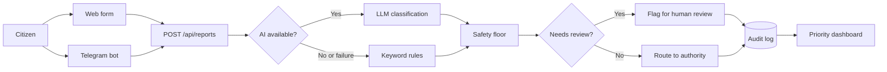
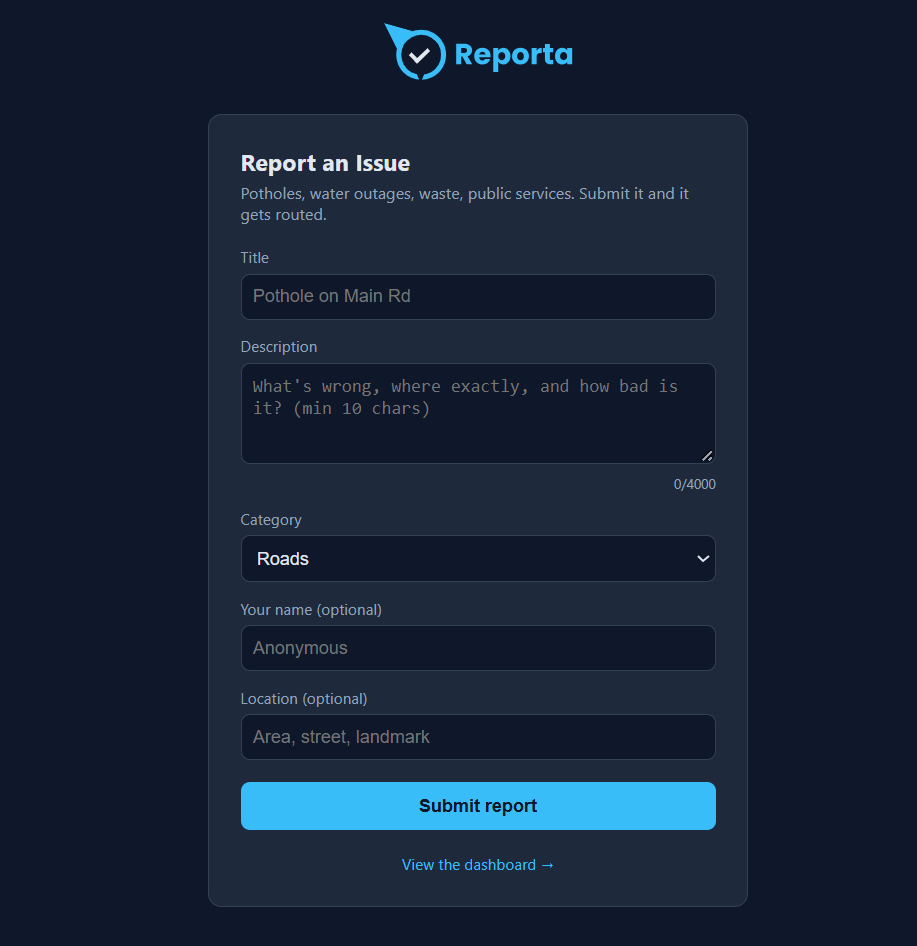
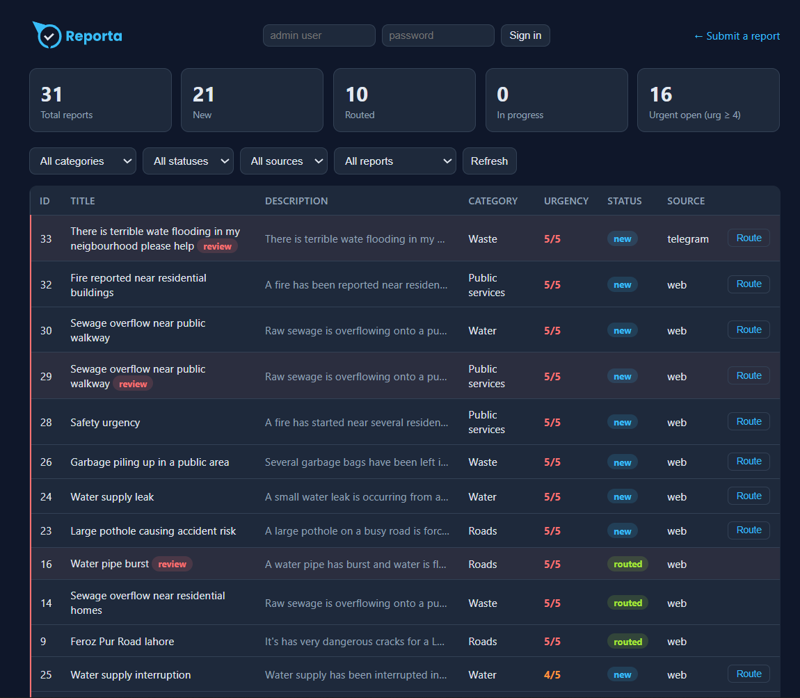
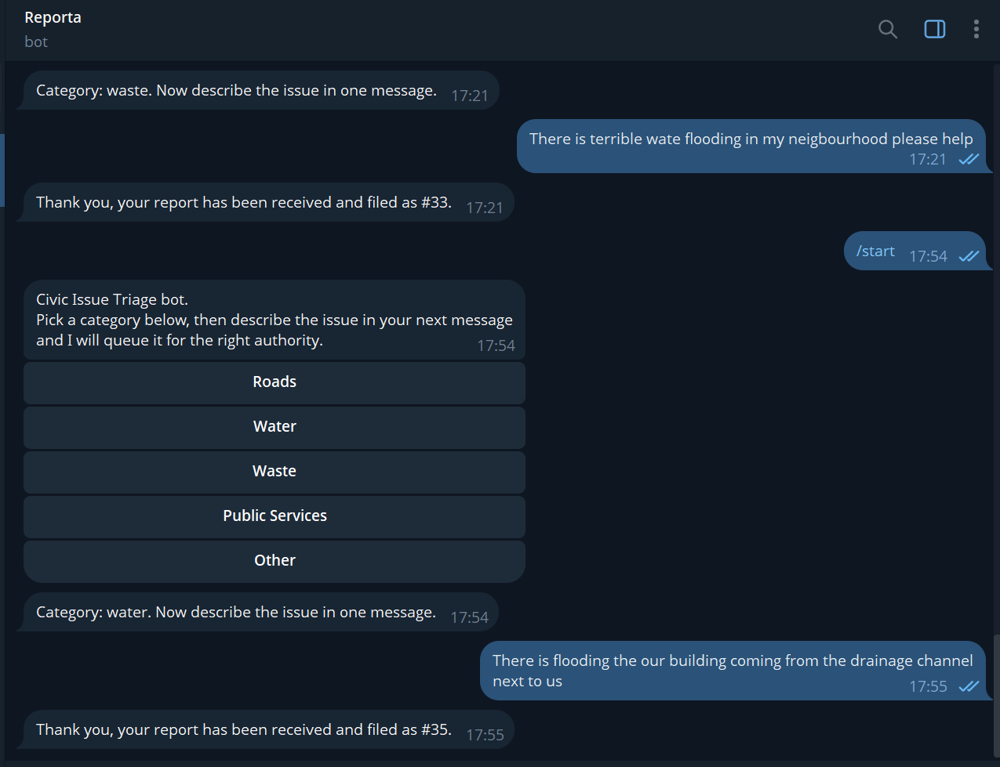
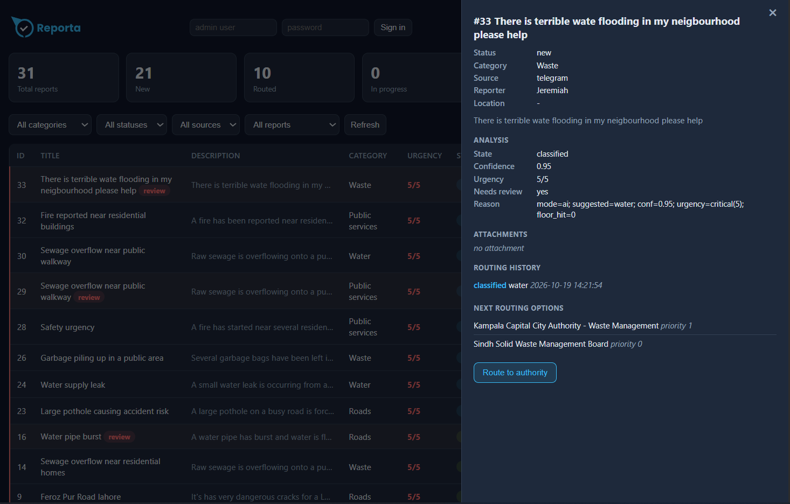

<div align="center">

# Reporta

### AI-assisted civic issue triage: report it, classify it, route it, track it.

*civic-issue-triage · Built for the NYLP AI Hackathon 2026*


**[Live demo](https://reporta.hingaai.tech)** · [Quickstart](#quickstart) · [How it works](#how-it-works) · [API](#api-reference) · [Team](#team)

</div>

---

## Table of Contents

1. [Overview](#overview)
2. [The Problem](#the-problem)
3. [Our Solution](#our-solution)
4. [Features](#features)
5. [How It Works](#how-it-works)
6. [AI Methodology](#ai-methodology)
7. [Tech Stack](#tech-stack)
8. [Quickstart](#quickstart)
9. [Configuration](#configuration)
10. [Telegram Bot](#telegram-bot)
11. [API Reference](#api-reference)
12. [Testing](#testing)
13. [Screenshots](#screenshots)
14. [Team](#team)
15. [Known Limitations](#known-limitations)
16. [Roadmap](#roadmap)
17. [License](#license)

---

## Overview

Reporta lets citizens report local service-delivery problems through a **web form** or a **Telegram bot**. Every report is:

- **classified** for urgency, using an AI model when available and keyword rules otherwise,
- **routed** to the local authority responsible for the defect, and
- **tracked** on a priority dashboard with a full audit trail.

The system is designed to **degrade gracefully and fail closed**: intake never blocks on the AI, safety-critical reports are never under-prioritised, and uncertain cases go to a human instead of being auto-routed.

**Live product:** https://reporta.hingaai.tech (public intake, login-protected dashboard)

---

## The Problem

Physical service-delivery defects (potholes, burst pipes, overflowing waste, broken streetlights, damaged public facilities) persist in cities long after citizens first report them. Feasibility research in Uganda and an independent market study of Karachi, Pakistan, describe the same failure from opposite ends.

| | Uganda | Karachi, Pakistan |
|---|---|---|
| **State of reporting** | The pipeline barely exists. | Complaint infrastructure exists at scale. |
| **Evidence** | No low-friction, persistent channel to the body responsible for fixing a defect. Existing channels (a call to a councillor, a radio phone-in, a WhatsApp group that dies within a week) are one-off and unaccountable. No verified public baseline exists for how long civic incidents take to resolve. | The Pakistan Citizen's Portal has processed over six million complaints, nearly one million of them in municipal services, yet reported satisfaction in that category is 47%. |
| **Failure mode** | Citizens cannot reach the right body persistently. | Responsibility for one visible problem is split across multiple authorities by service and exact location. Duplicate reports arrive as unrelated tickets. A complaint marked resolved is not independently verified as fixed. |

### The gap

The problem is not only whether a citizen *can* report. It is whether each report is:

1. **classified** consistently,
2. **routed** to the authority that actually owns the defect,
3. **linked to duplicates** so recurring problems become visible, and
4. **closed** only when the outcome is confirmed.

Reports that fail any of these steps die quietly. The cost, in both markets, is avoidable accidents and health hazards, wasted public spending, and citizens who stop reporting because nothing shows that reporting changes anything.

---

## Our Solution

This prototype demonstrates the **front of that pipeline**: classification with a keyword fallback and a safety floor, routing suggestions with human review on uncertain cases, and status tracking on an auditable dashboard.

Duplicate detection and citizen-confirmed resolution are on the [roadmap](#roadmap).

---

## Features

| Area | Capability |
|---|---|
| **Intake** | Public web form and a Telegram bot with a guided category-then-description flow |
| **Classification** | Hosted LLM for urgency and category when available; keyword rules otherwise |
| **Safety** | Raise-only safety floor for hazard terms (fire, flood, sewage, ...) in every mode |
| **Human oversight** | Fail-closed review flags for uncertain, default, or disputed classifications |
| **Routing** | Reports mapped to seeded local authorities |
| **Auditability** | Append-only log of every classification and routing decision |
| **Dashboard** | Priority view with filters for category, status, review flag, and source |

---

## How It Works



1. **Intake.** A report arrives via the web form at `/` or the Telegram bot.
2. **Classification.** With `GROQ_API_KEY` set, a hosted LLM classifies urgency and suggests a category. Without a key, or on any provider failure, intake degrades to keyword rules and **never blocks**.
3. **Safety floor.** Hazard terms raise urgency to a minimum level. The floor only raises and never lowers.
4. **Review gate.** Uncertain or default results are flagged for a human instead of being auto-routed.
5. **Routing and audit.** Reports map to seeded local authorities, and every decision is appended to the audit log.

---

## AI Methodology

### Classification

When `GROQ_API_KEY` is set, each report is sent to the model, which must return **strict JSON**. The call is timeout-guarded (`CLASSIFIER_TIMEOUT`, default 5 seconds) and retried once on a malformed or failed response.

### Graceful degradation

If there is no key, or the provider times out or errors, intake falls back to keyword rules. Submitting a report never depends on the AI being up.

### Safety floor

Safety-term matches (fire, flood, sewage, ...) raise urgency to at least `CLASSIFIER_SAFETY_FLOOR` (default `5`). The floor is **raise-only**: it never lowers urgency, in both AI and keyword modes.

### Fail-closed human review

A report is flagged for human review instead of being auto-routed when any of the following holds:

| Trigger | Why |
|---|---|
| Category is `other` | No reliable authority match |
| Classified in keyword mode | Rules are blunt, so a person should confirm |
| Confidence below `CLASSIFICATION_CONFIDENCE_FLOOR` (default `0.60`) | The model is unsure |
| Model disagreements | Conflicting signals should not be auto-resolved |

### Auditability

Every classification and routing decision is appended to an audit log so outcomes can be reviewed after the fact.


---

## Tech Stack

| Layer | Technology |
|---|---|
| Language | Python 3.14 |
| Backend | FastAPI |
| Database | SQLite (no database server required) |
| AI | Groq-hosted LLM (`openai/gpt-oss-120b` in the deployed instance) |
| Messaging | Telegram Bot API (outbound long-polling) |
| Packaging | Docker, Docker Compose |
| Testing | pytest |

**API usage**

- **Groq API:** classifies urgency and suggests a category for each report.
- **Telegram Bot API:** citizen intake channel.
- Voice-note transcription (`WHISPER_MODEL`) is planned and not enabled in this deployment.

---

## Quickstart

**Prerequisites:** Python 3.14 (or Docker).

```bash
git clone https://github.com/Stjr2090/civic-issue-triage
cd civic-issue-triage
python3 -m venv .venv && source .venv/bin/activate
pip install -r requirements.txt
python scripts/seed.py          # seeds 8 sample authorities
uvicorn app.main:app --host 0.0.0.0 --port 8000
```

| URL | Purpose |
|---|---|
| `http://localhost:8000` | Intake form |
| `http://localhost:8000/dashboard` | Priority dashboard |

**With Docker**

```bash
docker compose up --build       # PORT env var overrides the default 8000
```

---

## Configuration

All environment variables are **optional**. The app runs with sensible defaults and degrades gracefully.

| Variable | Default | Purpose |
|---|---|---|
| `DATABASE_PATH` | `./data/civic.db` | SQLite database location |
| `PORT` | `8000` | Server port (Docker image) |
| `GROQ_API_KEY` | none | Enables AI classification; without it, keyword fallback is used |
| `GROQ_MODEL` | `openai/gpt-oss-120b` (deployed) | Chat model used for classification; set a chat-capable model available on your account |
| `WHISPER_MODEL` | none | Voice-note transcription (audio intake); coming soon, not enabled in this deployment |
| `CLASSIFIER_TIMEOUT` | `5` | Seconds before the AI call gives up and falls back |
| `CLASSIFIER_SAFETY_FLOOR` | `5` | Minimum urgency for safety-term matches (raise-only) |
| `CLASSIFICATION_CONFIDENCE_FLOOR` | `0.60` | Confidence below this sends a report to human review |
| `TELEGRAM_BOT_TOKEN` | none | Enables the Telegram bot |
| `API_BASE` | `http://localhost:8000` | API URL the Telegram bot talks to |

> **Security note:** secrets belong in `.env` (already excluded via `.gitignore` and `.dockerignore`), never in the repository.

---

## Telegram Bot

```bash
export TELEGRAM_BOT_TOKEN=your-token
python -m app.telegram_bot
```

The bot uses **outbound long-polling only**, so no inbound ports are needed. A guided conversation (category, then description) files one report, with the reporter's handle recorded as source attribution.

---

## API Reference

| Method | Path | Purpose |
|---|---|---|
| `POST` | `/api/reports` | File a report |
| `GET` | `/api/reports` | List reports (filters: `?category=`, `?status=`, `?needs_review=`, `?source=`) |
| `GET` | `/api/reports/{id}` | Report detail |
| `PATCH` | `/api/reports/{id}/status` | Update report status |
| `GET` | `/api/stats` | Dashboard aggregates |
| `GET` | `/api/authorities` | Seeded local authorities |
| `GET` | `/api/route/{id}` | Route a report to its matching authority (`409` when no match) |
| `GET` | `/` | Intake form |
| `GET` | `/dashboard` | Priority dashboard |

---

## Testing

```bash
pytest
```

The suite contains 27 tests. They require no API keys and no network access, so they are safe to run in CI.

---

## Screenshots









---

## Team

| Name | Role |
|---|---|
| **Tumusiime Stephen** | Backend and API integrations |
| **Muhammad Younas** | Front end and product design |
| **Sadaf Mustafa** | Demo and presentation |
| **Aisha P** | Feasibility research and final submission |

---

## Known Limitations

This is a hackathon prototype. We would rather state its edges than hide them.

- **Intake is public; the dashboard is admin-only.** Intake stays public by design. Dashboard views and mutation endpoints sit behind login, with JWT sessions that expire after 12 hours.
- **Single-node SQLite.** One file. Schema changes run through a small idempotent SQL migration loader (`db/migrations`) rather than a full migration framework, and heavier schema work still favors a fresh volume and re-seed.
- **Confidence is model-reported, not calibrated.** The review threshold is a sensible heuristic, not a measured operating point.
- **Keyword fallback is blunt.** Substring matching can over-flag (the safe direction), and the safety terms are not an exhaustive multilingual list.
- **Intake is unthrottled.** No rate limiting on either intake path.
- **Routing records intent, it does not dispatch.** Authorities and contacts are seed data; no SMS or email is sent.
- **Reporter fields are stored in plaintext.** Real deployments need encryption and a retention policy.

---

## Roadmap

- [x] Authentication for dashboard operators
- [ ] PostgreSQL and schema migrations
- [ ] Notification dispatch (SMS/email) on routing
- [ ] Calibrated confidence thresholds and rate limiting
- [ ] Deeper multilingual intake support
- [ ] Duplicate detection across reports
- [ ] Citizen-confirmed resolution

---

## License

Released under the [MIT License](LICENSE).

<div align="center">

*Built for the NYLP AI Hackathon 2026.*

</div>
